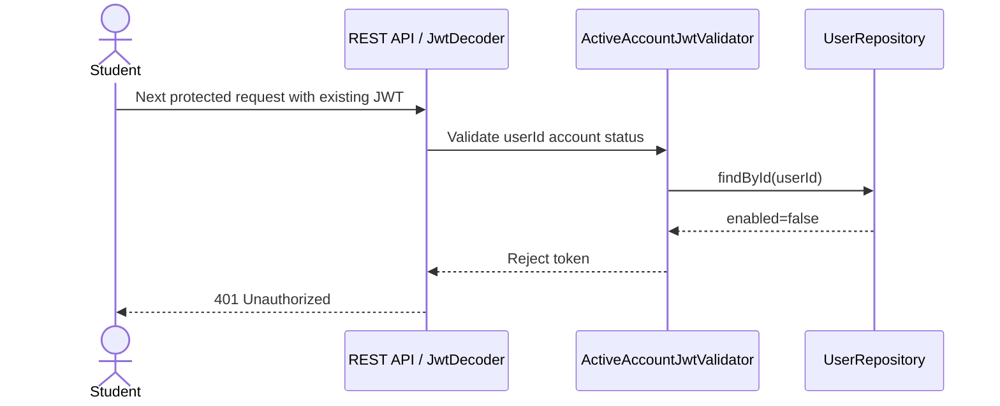

# Student (STU) Design

> Realizes: UC-STU-deactivate-student
> Depends on FRs: FR-SEC-deny-unauthorized, FR-SEC-active-account
> Depends on: BR-student-lifecycle, BR-student-deactivation-effects
> See: [use cases](../requirements/use-cases.md#student), [business rules](../requirements/business-rules.md), [SRS business domain model](../requirements/software-requirements-specification.md#business-domain-model), [architectural design](architectural-design.md) (Container and foundation component views; cross-cutting security)
> Designed against `design/uc-stu-deactivation-policy` at `6d86244` (2026-11-06).

## Overview

The student area owns course-admin and instructor operations on student accounts. Deactivation is an explicit lifecycle command on the existing `Student` model: it changes the inherited account-enabled flag, retains the student's team membership and submitted work, and uses the platform's shared JWT and authorization machinery.

## Components & classes

```mermaid
classDiagram
    direction LR
    class StudentsVue {
        <<reused, frontend>>
    }
    class EditStudentForm {
        <<reused, frontend>>
    }
    class StudentApi {
        <<reused, frontend>>
        +deactivateStudent(id)
        +updateStudent(student)
    }
    class StudentController {
        <<reused, student>>
        +deactivateStudent(studentId) Result
    }
    class StudentService {
        <<reused, student>>
        +deactivateStudent(studentId) Student
        +updateStudent(studentId, update) Student
    }
    class StudentSecurityService {
        <<reused, student>>
        +isCurrentUserInstructorOfStudentSection(student) boolean
    }
    class StudentRepository {
        <<reused, student>>
    }
    class Student {
        <<reused, student>>
    }
    class PeerEvaluationUser {
        <<reused, user>>
        +enabled boolean
    }
    class EvaluationService {
        <<reused, evaluation>>
        +submitPeerEvaluation(evaluation) PeerEvaluation
    }
    class SecurityConfiguration {
        <<reused, security>>
    }
    class ActiveAccountJwtValidator {
        <<new, security>>
        +validate(jwt) OAuth2TokenValidatorResult
    }
    class UserRepository {
        <<reused, user>>
    }
    class MyUserPrincipal {
        <<reused, user>>
        +isEnabled() boolean
    }
    class StudentAlreadyInactiveException {
        <<new, student>>
    }
    class ExceptionHandlerAdvice {
        <<reused, system>>
    }

    StudentsVue --> EditStudentForm
    StudentsVue --> StudentApi
    EditStudentForm --> StudentApi
    StudentApi --> StudentController
    SecurityConfiguration --> ActiveAccountJwtValidator
    SecurityConfiguration --> StudentController : route authorization
    StudentController --> StudentService
    StudentService --> StudentRepository
    StudentService --> StudentSecurityService
    StudentService ..> StudentAlreadyInactiveException
    StudentRepository --> Student
    Student --|> PeerEvaluationUser
    EvaluationService --> StudentRepository : reject inactive evaluatee
    ActiveAccountJwtValidator --> UserRepository
    MyUserPrincipal --> PeerEvaluationUser : login enabled check
    ExceptionHandlerAdvice ..> StudentAlreadyInactiveException : 409 mapping
```



- **Frontend:** reuse [`Students.vue`](../../frontend/src/pages/students/Students.vue), [`EditStudentForm.vue`](../../frontend/src/pages/students/EditStudentForm.vue), and [`apis/student`](../../frontend/src/apis/student/index.ts). The deactivation action presents the warning and calls the new API only after confirmation; cancel makes no request. The generic edit path cannot transition an active account to inactive.
- **Backend:** add a controller action and service operation in [`StudentController`](../../backend/src/main/java/team/projectpulse/student/StudentController.java) and [`StudentService`](../../backend/src/main/java/team/projectpulse/student/StudentService.java). Reuse [`StudentRepository`](../../backend/src/main/java/team/projectpulse/student/StudentRepository.java) and [`StudentSecurityService`](../../backend/src/main/java/team/projectpulse/student/StudentSecurityService.java); the service checks the instructor against the already-loaded student's course section.
- **Authentication and status:** add `ActiveAccountJwtValidator` in `security/`, wired through [`SecurityConfiguration`](../../backend/src/main/java/team/projectpulse/security/SecurityConfiguration.java) and [`UserRepository`](../../backend/src/main/java/team/projectpulse/user/UserRepository.java). The existing [`MyUserPrincipal.isEnabled`](../../backend/src/main/java/team/projectpulse/user/MyUserPrincipal.java) check continues to reject disabled users at Basic login. Add a 409 mapping for `StudentAlreadyInactiveException` in [`ExceptionHandlerAdvice`](../../backend/src/main/java/team/projectpulse/system/exception/ExceptionHandlerAdvice.java).
- **Peer evaluations:** add an inactive-evaluatee guard to [`EvaluationService`](../../backend/src/main/java/team/projectpulse/evaluation/EvaluationService.java). [`SubmissionStatusService`](../../backend/src/main/java/team/projectpulse/notification/SubmissionStatusService.java) already excludes inactive students from owed weekly activity report and peer-evaluation items.

## Sequence

### UC-STU-deactivate-student: main scenario and extensions

```mermaid
sequenceDiagram
    actor A as Course admin / instructor
    participant UI as Students UI
    participant SC as SecurityConfiguration
    participant C as StudentController
    participant S as StudentService
    participant SS as StudentSecurityService
    participant R as StudentRepository
    A->>UI: Choose student and deactivate (steps 1–3)
    UI-->>A: Show consequences and ask confirmation (step 4)
    alt cancel (5a)
        A->>UI: Cancel
        UI-->>A: Close warning; make no request
    else confirm (step 5)
        A->>UI: Confirm
        UI->>SC: POST /students/{studentId}/deactivate with JWT
        SC->>SC: Require ROLE_admin or ROLE_instructor
        alt no permitted role (6c)
            SC-->>UI: 403
        else permitted role
            SC->>C: Continue request
            C->>S: deactivateStudent(studentId)
            S->>R: findById(studentId)
            alt no student (6b)
                R-->>S: Empty
                S-->>UI: 404
            else student exists
                R-->>S: Student
                opt instructor caller
                    S->>SS: Check instructor's course-section assignment
                    SS-->>S: Assignment result
                end
                alt instructor not assigned (6c)
                    S-->>UI: 403
                else course admin or assigned instructor
                    alt already inactive (6a)
                        S-->>UI: 409
                    else active
                        S->>R: Save enabled=false; retain team and submitted work
                        R-->>S: Updated Student
                        S-->>C: Success
                        C-->>UI: 200 Result (step 6)
                        UI-->>A: Show deactivation confirmation (step 7)
                    end
                end
            end
        end
    end
```

### UC-STU-deactivate-student: next protected request



## API contract

| Endpoint or job | Caller (who may) | Request | Success | Errors, by extension |
|---|---|---|---|---|
| `POST ${api.endpoint.base-url}/students/{studentId}/deactivate` (new) | Authenticated course admin, or instructor assigned to the student's course section | `studentId` path variable; no body | `200 Result` | `401` invalid/disabled caller; `403` unauthorized role or instructor scope (6c); `404` student absent (6b); `409` already inactive (6a) |
| `PUT ${api.endpoint.base-url}/students/{studentId}` (changed guard) | Existing route authorization; student updates own profile, instructor updates a student in scope | Existing student update payload | `200 Result`; `enabled=false → true` still supports reactivation | `400` for `enabled=true → false`; deactivation must use the dedicated route |

## Key decisions

- **Dedicated command route:** use `POST …/deactivate` rather than the generic `PUT` as the deactivation path. The route makes confirmation, 409-on-repeat, and effects explicit. The generic update guard blocks only active-to-inactive; reactivation through that route remains supported.
- **Two-stage authorization and 404:** the filter-chain rule admits only `ROLE_admin` and `ROLE_instructor`; after loading the student, the service verifies section assignment. A resource-aware manager that looks up the student before the controller would turn an unknown ID into 403, contrary to extension 6b. This honors the UC's 404; it does mean an instructor can distinguish a nonexistent ID (404) from an existing out-of-section student (403).
- **Immediate disabled-account enforcement:** validate account status during each JWT decode rather than waiting for token expiry or adding a revocation list. A cache was rejected because it could allow a deactivated student's next protected request.
- **No lifecycle schema change:** reuse `PeerEvaluationUser.enabled`; do not add `deactivatedAt` or change team/report/evaluation relationships. Existing records remain available for their recorded weeks.
- **Inactive evaluatee response (design choice):** reject a new evaluation targeting an inactive student using the existing invalid-evaluation 400 response. The business rule specifies rejection, not an HTTP status.

## Data model

No schema delta or migration. The existing [`Student`](../../backend/src/main/java/team/projectpulse/student/Student.java) inherits `enabled` from `PeerEvaluationUser`; its section and team associations and the existing weekly activity and peer-evaluation records are retained. The shared model remains the SRS [Business Domain Model](../requirements/software-requirements-specification.md#business-domain-model).

## Reuse & cross-cutting

The route uses the shared `Result` envelope, `SecurityConfiguration`, and standard 401/403/404 handling. The active-account validator implements the existing `FR-SEC-active-account`; the course-admin/instructor scope follows `BR-student-lifecycle`. It rejects all protected bearer requests for a disabled account, including weekly activity report and peer-evaluation submissions; the existing login check also rejects disabled credentials. The peer-evaluation submission guard enforces `BR-student-deactivation-effects`; existing report generation continues to include team members regardless of current `enabled` status, while the existing owed-items service filters inactive students for both report and peer-evaluation reminders.

## Tests

| Use case, flow | Level (unit / integration) | Asserts |
|---|---|---|
| UC-STU-deactivate-student, main success | Integration | Course admin and assigned instructor can deactivate an active student; response succeeds; `enabled` becomes false; team membership and prior weekly activity reports and peer evaluations remain. |
| UC-STU-deactivate-student, 5a cancel | Cypress E2E | Cancel the warning; no deactivate request is sent and the account remains active. Assert the step-4 warning states the BR consequences: team membership and submitted work remain; no new evaluation may target her; reports retain her for active weeks; her next protected request is denied. |
| UC-STU-deactivate-student, 6a already inactive | Service + integration | An authorized caller receives 409 / `StatusCode.CONFLICT`; no further mutation occurs. |
| UC-STU-deactivate-student, 6b not found | Integration | An eligible-role caller receives 404 / `StatusCode.NOT_FOUND`, not 403. |
| UC-STU-deactivate-student, 6c unauthorized | Integration | A student caller is refused by the route rule and an instructor outside the student's course section by the service; both receive 403 and no state changes. |
| UC-STU-deactivate-student, logged-in student next protected request | Integration | Reuse a student JWT issued before deactivation to attempt a protected weekly activity report submission; receive 401 and persist no report. A fresh Basic login also returns 401. `FR-SEC-active-account` requires denying both authentication and access but specifies no HTTP status; 401 follows existing account-status and invalid-bearer handling. |
| Deactivation rule, new evaluation about inactive student | Service + integration | Submission is rejected with the existing 400 invalid-evaluation response (**design choice**; the rule specifies rejection, not a status); no evaluation row is created. |
| Deactivation rule, historical report visibility | Integration | Existing activity and peer-evaluation data remains visible in reports for weeks she was active. |
| Generic update lifecycle guard / reactivation | Integration | `PUT` active-to-inactive returns 400 with no mutation; `PUT` inactive-to-active still succeeds for reactivation. |

The 5a E2E case fits the existing Cypress setup: use `cy.login` and stub the student API with `cy.intercept`, following the existing cancel/no-request pattern in `reminders.spec.cy.js`. Cypress is already installed; no new frontend test runner is needed. The current login helper expects the dev backend to be running.

## Open questions / risks

- The per-request account lookup makes each bearer-authenticated request depend on the user store; do not cache the status unless the design changes the immediate-denial requirement.
- Extension 6b's explicit 404 creates the existence distinction described above for an instructor caller. Returning a uniform 403 would require changing the accepted UC behavior.
- The reactivation operation remains on the existing generic update path; a dedicated reactivation route is outside this use case's design.
